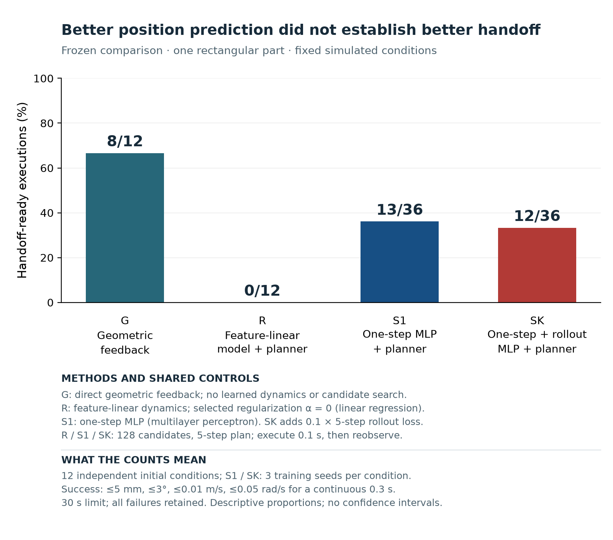

# pre_worldmodel

**학습한 미래가 더 정확하면, 로봇의 선택과 작업 결과도 좋아질까?**

MuJoCo에서 어긋난 직사각형 부품을 옆에서 밀어 다음 공정의 인계 조건으로 가정한 위치·방향에 맞추는 프로젝트입니다. 작은 신경망의 행동 조건부 동역학, 재귀 예측, MPC 방식의 후보 선택을 구현하고 **예측 오차 → 후보 선택 → 실제 인계**를 각각 평가했습니다.

사업 적용 맥락을 둔 기술 검증·학습 프로젝트입니다. 학습 기술을 직접 다루는 목표와, 그 기술이 더 우수하다는 주장을 분리했습니다. 새 알고리즘·실물 적용·고객 ROI를 입증한 프로젝트는 아닙니다.

## 먼저 읽기

| 목적 | GitHub에서 읽는 원본 | 내려받는 PDF |
|---|---|---|
| 문제 가치·목표 달성·실무 의사결정 | [사업 관점 보고서](docs/business_report.ko.md) | [실무 요약 PDF](reports/Business_Report.ko.pdf) |
| 학술 논문: 정식화·방법·실험·결과·논의 | [LaTeX 원고와 생성 방법](paper/README.md) | [2단 학술 논문 PDF](reports/Research_Paper.ko.pdf) |
| 포함 자료·출처·재현 명령 | [근거·재현 색인](artifacts/index.md) | 핵심 근거는 두 PDF 본문·부록에도 수록 |
| 파일 형식과 갱신 방법 | [문서 운영 안내](docs/documentation.ko.md) | PDF와 MD의 역할·링크 동작 설명 |

GitHub에서는 Markdown을 바로 읽을 수 있습니다. PDF의 목차·근거 링크는 다운로드 후 사용하세요. [GitHub 공식 문서](https://docs.github.com/en/repositories/working-with-files/using-files/working-with-non-code-files)에 따르면 PDF 미리보기에서는 내부 링크가 무시됩니다.

학술 논문은 IEEEtran conference 클래스의 2단 LaTeX 조판으로 작성했습니다. 수식·그림·표·참고문헌에 번호를 부여하고 본문에서 상호 참조합니다. 기존 [10쪽 기술 보고서](docs/technical_report.ko.md)와 [그 PDF](reports/Technical_Report.ko.pdf)는 프로젝트 설명용 보조 문서로 보존합니다.

## 최종 결과

| 방법 | 구성 | 인계 성공 |
|---|---|---|
| G | 조정된 기하 피드백 | 8/12 |
| R | 선형 증분 동역학 + 공통 계획기 | 0/12 |
| S1 | 한 단계 학습 MLP + 공통 계획기 | 13/36 |
| SK | 한 단계 + K5 자유 예측 학습 MLP + 공통 계획기 | 12/36 |

독립 초기조건은 **12개**입니다. 신경망의 36회는 같은 12조건×학습 seed3개의 실행 수입니다. 96개 합계 중 성공33개를 한 방법의 성공률로 제시하지 않습니다.

일부 seed에서 SK의 고정 행동 K5·K10 위치 예측은 개선됐지만 **후보 선택손실과 인계 성공 개선은 확인되지 않았습니다.** E1의 S1/SK 36쌍 중 35쌍은 같은 후보를 선택했습니다. SK-S1 인계 성공 차이는 -2.78%p, family bootstrap 95% 구간은 [-8.33,0.00]입니다. 동등성을 입증하는 구간이 아닙니다.

실제 관측의 도식 재생: [병진](assets/media/clip_translation.gif) · [회전](assets/media/clip_rotation.gif) · [오프셋](assets/media/clip_offset.gif). 결과와 무관하게 미리 정한 최소 ID 조건을 보여줍니다. 이 세 예시에서는 병진 G만 성공했고, 학습 방법의 다른 성공 사례는 전체96개 결과에 포함돼 있습니다. 먼저 종료한 패널의 정지 화면과 표시용 끝1초는 추가 실측 유지 시간이 아닙니다.

## 어떤 프로젝트인가

상태10·명령2 → 특징11 → MLP 11-128-128-10의 상태 증분 예측 → H5 재귀 예측 → 후보128개 비용 비교 → 첫0.1초 실행 → 재관측으로 이어집니다. 실제 물리 간격은0.5ms입니다. 속도 서보·접촉 물리·목표 자세 안의 영 명령 유지·인계 판정은 기존 제어기와 공통 감독기가 담당합니다.

인계는 위치5mm·방향3°·선속도0.01m/s·각속도0.05rad/s 이하를 연속0.3초 유지해야 합니다. 최대30초·작업 재시도0회입니다. 이 문턱은 실험 명세이며 산업 공차가 아닙니다.

원래 실험·보고 절차는28/28개 완료했습니다. 모델 우위·일반적인 작업 성공률·현장 도입 효과·개인 역량까지 모두 달성했다는 뜻은 아닙니다. 실패와 중단, 무효 예측을 포함한 결과를 보존했습니다.

## 코드와 재현

`src/push_align`은 환경·동역학·학습·계획·판정·최종 기록 코드를 담습니다. `configs`, `assets`, `scripts`, `tests`, `tools`는 관련 설정과 실행·검증 도구입니다. 역사적 실행 도구 중에는 공개하지 않은 원시 자료를 요구하는 것도 있습니다. 공개본으로 실제 확인한 명령과 범위는 [근거·재현 색인](artifacts/index.md)을 따르세요.

공개본에는 선별된 모델·정규화·자료·통계·행동 경계 기록을 포함합니다. 전체 고주파 물리 원시와 모든 과거 실험 폴더는 제외했습니다. 원본 출처 SHA와 공개 경로를 변환한 파일의 SHA는 구분합니다. 일부 전체 감사 명령이 요구하는 로컬 보관 자료까지 공개본에 있다고 주장하지 않습니다.

## 작업과 AI 활용

사용자는 문제의 의미·학습 목표·평가 기준·진행 방향을 논의하고 선택했습니다. Codex는 구현·학습·반복 실행·검산·시각화·문서 작성을 도왔습니다. 이 저장소의 코드량이나 자동 검사의 통과를 사용자의 단독 개발 또는 개인 이해를 입증하는 수치로 바꾸지 않습니다. 설명·수정·검증 역량은 별도로 확인할 대상입니다.
