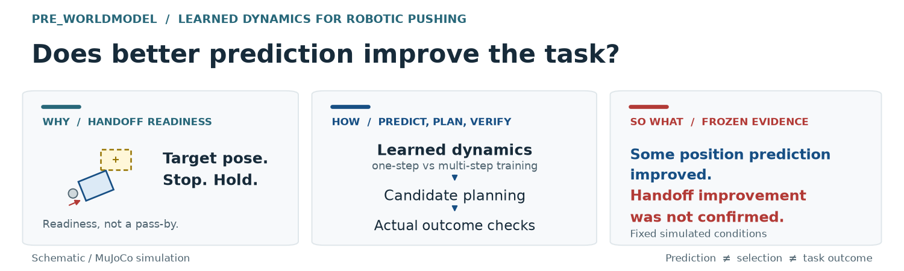
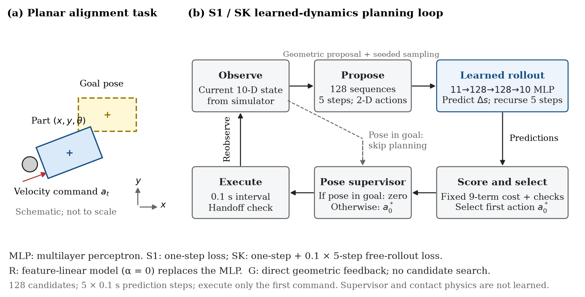

# pre_worldmodel

### 학습한 미래를 행동으로 연결하기 — 부품 밀기의 예측·선택·인계 검증



**다음 움직임을 더 잘 예측하면, 선택한 행동과 작업 결과도 좋아질까?**

작업대의 어긋난 직사각형 부품을 XY 푸셔로 밀어 목표 위치·방향에 맞추는 MuJoCo 시뮬레이션입니다. 행동에 따른 상태 변화를 작은 신경망으로 학습하고, 그 예측으로 밀 방향과 속도를 선택합니다.

[논문 PDF](reports/Research_Paper.ko.pdf) · [실무 의미](docs/business_report.ko.md) · [결과·재현 근거](artifacts/index.md) · [다음 진단 설계](docs/near_goal_diagnostic_design.ko.md)

| 한눈에 보기 | 이번 프로젝트의 답 |
|---|---|
| **WHY · 문제의 의미** | 다음 공정으로 넘길 부품은 위치·방향을 맞추고 멈춰 있어야 합니다. 목표 통과와 준비 완료를 구분합니다. |
| **WHAT · 기술적 질문** | 한 단계 학습에 다단계 자유 예측 학습을 추가하면 예측, 후보 선택, 실제 인계가 각각 어떻게 달라지는가? |
| **HOW · 접근** | 같은 출발점에서 학습을 분기하고, 같은 계획 설정으로 고정 행동 예측 → 실제 후보 비용 → 폐루프 인계를 따로 평가합니다. |
| **SO WHAT · 확인한 결과** | 일부 위치 예측은 개선됐지만 다단계 학습의 인계 성공 개선은 확인하지 못했습니다. 목표 근처의 같은 후보를 대조해야 원인 가설을 더 좁힐 수 있습니다. |

이 저장소는 **상태 기반 학습 동역학·계획의 제한 조건 사례 연구**입니다. 새 알고리즘이나 실물 성능·고객 비용 절감을 입증한 프로젝트로 제시하지 않습니다.

<details>
<summary><strong>읽는 순서</strong> — 문제부터 보기 / 결과부터 보기 / 코드와 근거 확인</summary>

- 처음 읽는 경우: 아래 문제·성공 기준 → 학습/제어 구조 → 비교와 결과.
- 연구 관점: [학술 원고](paper/README.md) → [리뷰어 관점 평가](docs/reviewer_assessment.ko.md) → [보완 진단 설계](docs/near_goal_diagnostic_design.ko.md).
- 재현 관점: [공개 범위와 검산](artifacts/index.md) → [입출력·학습·계획 코드](src/push_align/).

</details>

## 1. WHY · 어떤 작업을 끝내려는가

부품 공급·취급에서는 다음 장치가 받을 위치와 방향을 맞춰야 할 수 있습니다. 이 과제에서는 부품이 목표를 지나가는 것과 다음 작업에 넘길 준비가 된 것을 구분했습니다. 다음 조건을 모두 만족하고 **0.3초 동안 유지**해야 인계 준비 성공으로 판정합니다.

| 판정 항목 | 실험 기준 |
|---|---|
| 위치 오차 | 5mm 이하 |
| 방향 오차 | 직사각형의 180° 대칭을 고려해 3° 이하 |
| 부품 선속도 / 각속도 | 0.01m/s / 0.05rad/s 이하 |
| 유지 / 제한 시간 | 0.3초 유지 / 최대 30초, 작업 재시도 0회 |

이는 실험에서 정한 인계 조건입니다. 후속 로봇의 실제 집기·삽입까지 실행한 것은 아닙니다. 판정은 0.5ms 물리 표본을 확인하고 행동 구간 끝에서 내립니다.

[공개된 부품 공급 사례](https://www.fortvillefeeders.com/dual-three-position-shuttle-for-small-lightweight-parts/)는 전용 툴링·트랙·셔틀을 사용합니다. 이 사례는 작업의 배경과 기계식 대안의 근거입니다. 이번 밀기 모듈의 고객 수요나 학습 모델의 필요성까지 입증하지는 않습니다. 직접 집기·지그·피더도 현장에서 비교해야 할 대안입니다.

## 2. HOW · 무엇을 학습하고 어떻게 행동하는가



*개념도. S1은 한 단계 손실로 학습한 MLP(다층 신경망), SK는 같은 구조에 `0.1×5단계 자유 예측 손실`을 추가한 모델입니다. R은 선형 동역학으로 신경망을 대체하며, G는 후보 계획 없이 직접 기하 피드백을 사용합니다. R/S1/SK는 128후보·5단계(0.5초)를 평가하고 첫 0.1초만 실행합니다. 목표 자세 안에서는 공통 감독기가 영 명령을 적용합니다. 그림은 실물 사진·측정 궤적이 아닙니다.*

| 부분 | 담당하는 일 |
|---|---|
| 관측 | 시뮬레이터의 부품·푸셔 위치, 방향, 속도 10개 상태를 읽음 |
| 학습 동역학 | 상대 위치·방향·속도·명령의 11차원 입력으로 다음 0.1초의 전체 상태 증분 10개를 예측 |
| 공통 계획기 | 예측을 5번 이어 0.5초 미래를 만들고, 128개 후보 명령열의 비용·유효성을 비교 |
| 실제 실행 | 고른 명령열의 첫 0.1초만 적용한 뒤 새 상태를 읽고 다시 계획 |
| 기존 서보·물리·감독기 | 목표 속도 추종, 접촉 적분, 목표 자세 안의 영 명령, 정지·유지 판정 |

신경망은 **MLP 11→128→128→10, SiLU, 19,338개 파라미터**입니다. 푸셔의 미래 상태도 예측합니다. 시각 인식·언어 모델·VLA를 사용하지 않는 상태 기반 동역학 모델이며, 계획 중 실제 미래 물리를 조회하지 않습니다.

비용은 위치·방향·명령·간격과 마지막 속도를 평가합니다. **0.3초 유지시간 자체나 미래 감독기 전환은 비용에 명시적으로 들어 있지 않습니다.** 낮은 예측 비용과 실제 인계 성공은 별도로 검사해야 합니다.

## 3. WHAT · 같은 조건에서 무엇을 비교했는가

주된 질문은 **한 단계 학습에 다단계 자유 예측 손실을 추가하면 무엇이 달라지는가**입니다.

| 방법 | 의미 | 인계 준비 성공 |
|---|---|---|
| G | 학습 없이 현재 위치·방향으로 움직이는 조정된 기하 피드백 | 8/12 |
| R | 같은 입력 특징에서 배운 선형 상태변화 + 공통 계획기 | 0/12 |
| S1 | 실제 다음 상태를 맞추도록 학습한 신경망 + 공통 계획기 | 13/36 |
| SK | S1과 같은 출발점에서 5단계 자유 예측 손실도 추가한 신경망 + 공통 계획기 | 12/36 |

독립 초기조건은 **12개**입니다. 병진·회전·접촉 위치 오프셋을 각 4개씩 정했습니다. S1/SK의 36회는 같은 12조건에 학습 난수(seed) 11·23·47을 적용한 수이며, 독립 초기조건 36개가 아닙니다. 시간 초과와 계획·제어 실패도 분모에 남겼습니다.

S1/SK는 같은 출발 가중치·Adam 상태·자료·배치 순서에서 각각 1,000회 추가 갱신했습니다. SK의 손실은 `한 단계 손실 + 0.1 × 5단계 자유 예측 손실`입니다. 갱신 수를 맞춘 비교이며 연산량·수렴 정도까지 같다는 뜻은 아닙니다. G와 학습 계획기의 차이에는 제어 구조도 포함됩니다.

평가는 세 수준으로 분리했습니다. `K5`는 5단계, 즉 0.5초 예측을 뜻합니다.

| 평가 | 확인하는 질문 | 범위 |
|---|---|---|
| 고정 행동 예측 | 같은 실제 상태·행동에서 미래 위치를 더 잘 맞추는가? | G의 12개 경로, K1·K5·K10 |
| E1: 후보 선택 | 같은 후보 중 고른 행동열의 실제 비용 손실은 얼마인가? | G 경로의 6개 초기조건·12상태, 16후보×실제 3반복 |
| E2: 폐루프 인계 | 각 방법이 스스로 행동했을 때 준비 조건을 만족하는가? | 12초기조건×8개 방법·seed 조합 = 96회 |

E1의 실제 미래 실행은 선택 이후의 오프라인 대조입니다. 온라인 계획기에 정답 미래를 제공하지 않았습니다.

## 4. SO WHAT · 예측 개선은 작업 개선으로 이어졌는가


*G=기하 피드백, R=선형 동역학(선택 정규화 α=0)+계획기, S1=한 단계 MLP+계획기, SK=한 단계+0.1×5단계 자유 예측 MLP+계획기. 독립 초기조건은 12개이며 S1/SK의 36회는 세 학습 seed를 적용한 실행 수입니다. 막대는 실패를 포함한 기술 비율이며 신뢰구간은 표시하지 않았습니다. 성공은 5mm·3°·0.01m/s·0.05rad/s 조건의 0.3초 연속 유지입니다.*

- **위치 예측:** 같은 유효 창을 비교할 수 있는 seed 23·47에서 SK의 K5·K10 위치오차가 낮았습니다. seed 23의 K5는 0.090605→0.058647mm였습니다. 모든 상태 성분이 좋아진 것은 아닙니다. seed 47은 방향·각속도 오차가 소폭 커졌습니다.
- **후보 선택:** E1의 S1/SK 36쌍 중 35쌍은 같은 후보를 골랐고, SK의 실제 선택손실 개선은 확인하지 못했습니다. E1은 접근 단계의 작은 후보군 진단입니다.
- **인계:** SK−S1 성공 비율 차이는 **−2.78%p**, 95% family bootstrap 구간은 **[−8.33, 0.00]%p**입니다. 36쌍의 결과는 동시 성공 12·동시 실패 23·S1만 성공 1·SK만 성공 0이었습니다. 차이는 병진 조건 03의 seed 23 한 쌍에서 나왔습니다.
- **실패:** 63개 실패 중 종료 위치 조건 미충족이 62개였습니다. 이는 관찰한 증상이며 모델·비용·후보 탐색 중 무엇이 원인인지 확정한 수치는 아닙니다.

신뢰구간은 초기조건 단위로 학습 seed를 먼저 평균한 뒤 재표집한 값입니다. 학습 seed 모집단이나 현장 발생률 전체의 불확실성을 반영하지 않으며, 0을 포함한다고 동등성이 입증되는 것도 아닙니다.

실제 관측의 도식 재생: [병진](assets/media/clip_translation.gif) · [회전](assets/media/clip_rotation.gif) · [오프셋](assets/media/clip_offset.gif). 결과와 무관하게 최소 ID로 정한 예시입니다. 먼저 종료한 화면과 표시용 마지막 1초는 추가 측정 유지시간이 아닙니다. 예시 영상만으로 전체 성능을 평가하지 않습니다.

## 5. CONTRIBUTIONS · 무엇을 구현하고 검증했는가

**프로젝트에서 구현·검증한 것**은 다음과 같습니다.

| 구현·실증 기여 | 검토할 산출물 |
|---|---|
| **학습에서 행동까지의 실행 구조** — 상태·명령·시간의 입출력 계약, 모델·계획·기존 제어의 책임 명시 | [학습 동역학](src/push_align/sequence_training.py), [후보 계획](src/push_align/planning.py), [실행·판정](src/push_align/final_execution.py) |
| **학습 목적의 통제된 비교** — 공통 출발점에서 분기한 S1/SK, 예측·실제 선택 비용·작업 결과의 분리 | [학습 분기 설정](configs/p4_fork_budget.v2.json), [선택 진단](artifacts/results/E1/), [최종 96개 결과](artifacts/results/E2/rows.json) |
| **결과를 추적할 수 있는 근거 묶음** — 무효·실패·저장 중단 보존, 모델·결과·출처 SHA 연결 | [자료·모델·결과 색인](artifacts/index.md), [공개 파일 검사](scripts/verify_public_results.py), [논문 수치 검산](scripts/verify_paper_results.py) |

이는 새 알고리즘의 독창성이나 일반적인 성능 우위와 구별되는 구현·실증 기여입니다. 학습 예측을 행동 선택에 연결해 검사할 수 있게 됐으며, 현재 결과는 그 효과를 제한해서 설명할 수 있는 사례입니다.

**추가 실험이 필요한 부분**도 남아 있습니다.

- E1은 시작과 2.9초의 G 상태만 포함하고, 실제 후보 끝점도 목표에서 최소 약 49.462mm 떨어져 있었습니다. 마지막 5mm 정렬·정지·유지를 진단한 실험이 아닙니다. 회전·오프셋의 초기 부호도 한쪽만 포함합니다.
- 고정 예측, E1, E2는 상태 분포와 후보군이 다릅니다. 세 결과만으로 예측 개선이 어느 연결에서 끊겼는지 인과적으로 설명할 수 없습니다.
- 현재 학습 예산의 결과이며 두 학습 목적의 수렴이나 학습률·손실 가중치의 최적성을 입증하지 않았습니다.
- 형상·질량·마찰·접근 면을 고정했습니다. 센서 오차·지연·실물·후속 집기·사업 효과는 평가하지 않았습니다.
- R은 선형 모델 기준선입니다. 분석적 밀기 모델·GP·불확실성 기반 계획 전체를 대표하지 않습니다.

### 후속 진단 · 전체 실행 진입 후 자원 상한으로 부분 중단

**2026-10-22: D1/D2를 완료했습니다.** offset-00/S1-23/tick254의 전체 물리 상태·제어 문맥·128후보가 원래 기록과 정확히 일치했습니다. 목표 근방의 다른 상태도 복원해 두 상태의 첫 16후보를 A/B에서 각각 3회 실행했습니다(192궤적; 독립 초기조건 192개가 아님).

- **새 관찰:** 실패 직전 상태의 첫 16후보 ID는 실제 A에서 모두 물리 유효했지만 여섯 신경망은 전부 예측상 거절했습니다. 해당 명령들이 정렬 준비까지 성공했다는 뜻은 아닙니다.
- **판정 구분:** 목표 근방 후보9는 B의 0.6초에서 준비됐고 같은 0.5초까지는 A/B 모두 미달했습니다. 정지 규칙만의 효과·비용 결함·기존 전체 정책의 개선으로 해석하지 않습니다.
- **전체 D3 진입 보류:** 원래 6상태 D3는 2시간 예산을 넘습니다. [저장·재현 시간 분리 측정](docs/followup_resource_profile.ko.md) 이후, 범위를 N-T 한 상태로 제한했습니다.
- **N-T 전체 실행은 70/768회에서 자원 중단:** [18건 사전 검사](docs/nt_fullbank_preflight.ko.md) 이후 [전체 진입점·실시간 상한 검사](docs/nt_fullbank_execution.ko.md)를 연결했습니다. 7모델×128후보 예측을 먼저 봉인하고 새 실제 미래를 실행했지만, 전체 결과 저장·복원 단가의 관측 최대값이 늘어 남은 검증·정리 포함 예상이 **121.73분**으로 2시간을 넘었습니다. 실제 누적 실행은 **15.88분**이며 70회 raw·24그룹 완전 결과와 검증을 보존하고 중단했습니다. **698회는 미실행, 전체 후보 순위·선택 손실은 미확인**입니다. 재학습·자동 재시도·기존 결과 교체는 없습니다.


*사후 선정한 두 실패 상태의 사례입니다. S1은 한 단계 학습 MLP(다층 신경망), 11·23은 학습 seed입니다. A는 같은 명령 0.5초, B는 현재 자세에 따른 영 명령과 추가 정지시간을 포함합니다. 그림은 첫 반복이며 세 실제 반복이 일치했습니다. F-O0의 16개 ID에는 중복이 있어 명령열은 10종입니다. 전체 128후보의 성능이나 단독 실패 원인을 입증하지 않습니다.*

[실행 결과·가설·자원 판단](docs/followup_restore_and_pilot.ko.md) · [실행 전 설계 v1](docs/near_goal_diagnostic_design.ko.md) · [독립 raw 검토](artifacts/validation/followup_execution_review.v1.json) · [공개 수치 검산](artifacts/validation/followup_public_results.v1.json)

[기록·재현 비용 분리와 다음 범위](docs/followup_resource_profile.ko.md) · [자원 산식](artifacts/followup/20261022-resource-profile/resource_summary.json) · [측정 자료 검토](artifacts/validation/followup_profile_execution_review.v1.json)

[N-T 전체128 사전 검사](docs/nt_fullbank_preflight.ko.md) · [전체 실행·자원 중단 보고](docs/nt_fullbank_execution.ko.md) · [선별 공개 자료](artifacts/followup/20261022-nt-full/manifest.json) · [실행 독립 감사](artifacts/validation/nt_full_execution_review.v1.json)

기존 동결 비교·논문 결과는 유지했습니다. [실행 전 main 보존 브랜치](https://github.com/codemillss/pre_worldmodel/tree/codex/frozen-main-before-followup-20261022)를 남기고 현재 main에서 후속 개발을 계속합니다.

## 6. 직접 확인하기

내용을 읽는 데 설치는 필요하지 않습니다. 저장 결과의 파일 SHA와 실행 개수를 확인하는 최소 검사는 Python 표준 라이브러리만 사용합니다.

```sh
git clone https://github.com/codemillss/pre_worldmodel.git
cd pre_worldmodel
python3 -B scripts/verify_public_results.py
```

Python 3.11 이상과 NumPy가 준비된 환경에서는 다음 명령으로 논문의 표·그림, E1/E2 요약과 bootstrap 배열을 재계산할 수 있습니다. 모델 추론·물리 실행·재학습은 하지 않습니다.

```sh
python -B scripts/verify_paper_results.py
```

설치한 환경에서 기존 모델 7개를 로드하고 최소 물리를 실행하는 검사는 `scripts/smoke_public.py`입니다. [설치 환경·정확한 명령·공개 범위](artifacts/index.md)를 먼저 확인하세요. 전체 고주파 원시·공통 출발 checkpoint·과거 실행 폴더가 생략되어 있어 공개본으로 전체 학습·최종 실험 운영을 즉시 재실행할 수 있다고 보장하지 않습니다.

| 경로 | 내용 |
|---|---|
| [src/push_align](src/push_align/) | 물리 환경, 동역학, 학습, 후보 계획, 판정·기록 |
| [configs](configs/) | 자료·학습·계획·최종 동결 설정 |
| [artifacts](artifacts/index.md) | 선별 자료·모델·결과·출처와 검산 범위 |
| [scripts](scripts/) / [tests](tests/) / [tools](tools/) | 실행·검사·분석·문서 생성 도구. 일부 과거 도구는 미공개 원시를 요구 |

## 7. 문서와 기여 역할

| 읽는 목적 | 원본 | PDF |
|---|---|---|
| 문제·방법·실험을 학술 형식으로 검토 | [LaTeX 논문](paper/README.md) | [학술 논문](reports/Research_Paper.ko.pdf) |
| 적용 판단·목표 달성·실무 의미 | [사업 관점 보고서](docs/business_report.ko.md) | [실무 요약](reports/Business_Report.ko.pdf) |
| 개발 경과·국소 진단·전체 설명 | [기술 보고서](docs/technical_report.ko.md) | [설명용 기술 보고서](reports/Technical_Report.ko.pdf) |
| 리뷰 지적과 수정·미해결 사항 | [리뷰어 관점 검토](docs/reviewer_assessment.ko.md) | 원문에서 코드·결과 연결 |
| 목표 근처·실패 직전 보완 실험 | [복원·사전 실행 결과](docs/followup_restore_and_pilot.ko.md), [실행 전 설계](docs/near_goal_diagnostic_design.ko.md) | D1/D2 완료, D3 미실행 |
| 원본 보존·검증을 유지하는 실행 비용 측정 | [시간 분리와 범위 판단](docs/followup_resource_profile.ko.md) | 측정 완료, N-T 사전 검사로 후속 검증 |
| N-T 전체128 실행기 사전 검사 | [검사 결과·실측·예산](docs/nt_fullbank_preflight.ko.md) | 통과, 18건 별도 보존 |
| N-T 전체 실행·실시간 자원 검사 | [부분 실행과 중단 근거](docs/nt_fullbank_execution.ko.md) | 70/768회 저장·검증 후 자원 중단; 698회 미실행 |

논문은 TeX→PDF, 두 보고서는 Markdown→PDF로 관리합니다. PDF의 링크·목차는 내려받아 사용하세요. [문서 운영·갱신 방법](docs/documentation.ko.md)에 원본과 검토 기록을 정리했습니다.

사용자는 문제 가치·학습 목표·평가 기준·진행 및 보류 판단을 논의하고 선택했습니다. Codex는 구현·학습·반복 실행·검산·시각화·문서 작성을 지원했습니다. 여기서 설명한 프로젝트 산출물과 사용자가 직접 한 판단을 구분합니다.

2026-10-22 갱신: D1 복원과 D2 작은 사전 실행을 별도 개발 기록으로 추가했습니다. 모델·물리·비용·원래 동결 결과는 유지했고, D3는 자원 진입을 보류했습니다.
