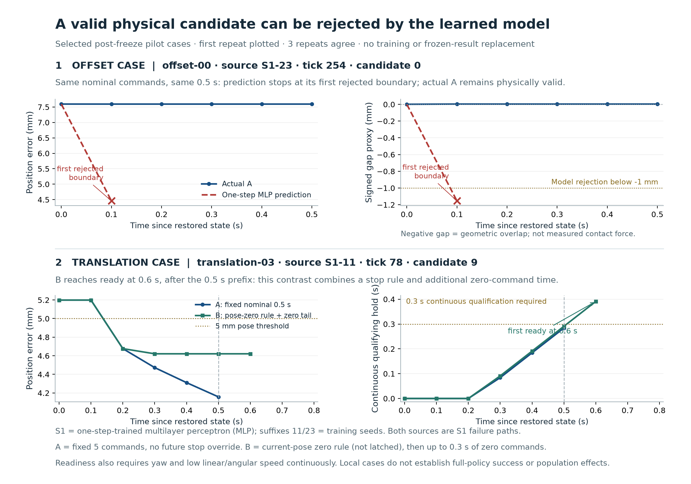

# 목표 근처 보완 진단: 복원 검사와 작은 사전 실행

2026-10-22 · D1/D2 실행·검토 완료 · **D3 미실행 / 자원 재검토 필요**

## 1. 이번 실행의 목적과 범위

원래 동결 비교 이후 [설계 v1](near_goal_diagnostic_design.ko.md)에 따라, 실패 직전의 같은 상태·후보를 모델과 실제 물리에서 비교할 수 있는지 검사했다. 먼저 offset-00/S1-23/tick254의 전체 상태·문맥·후보를 복원했고, 통과 후 목표 근방의 translation-03/S1-11/tick78을 추가 복원했다. 두 상태의 원래 후보 ID 0–15를 A/B에서 3회씩 실행했다.

원래 모델·정규화·물리·9항 비용·인계 기준·E1/E2 결과는 유지했다. 재학습·전체 128후보 진단·추가 후보 탐색은 하지 않았다. 작업은 계속 main에서 진행하며, 실행 전 main은 [보존 브랜치](https://github.com/codemillss/pre_worldmodel/tree/codex/frozen-main-before-followup-20261022)에 남겼다(기준 커밋 6d6d1fd).

## 2. D1: 무엇이 원래 기록과 일치했는가

| 검사 | F-O0: offset-00/S1-23/tick254 | N-T: translation-03/S1-11/tick78 |
|---|---|---|
| 원래 실제 명령 재생 | 254구간 | 78구간 |
| 전체 StepResult 비교 | 254개 정확 일치 | 78개 정확 일치 |
| 물리 하위 표본 | 50,800개 | 15,600개 |
| task/planner/G 문맥 | 매 구간 전후 정확 일치 | 매 구간 전후 정확 일치 |
| 전체 128후보 | 원본 배열·해시 정확 일치 | 원래 witness 해시 정확 일치 |
| 전체 내부 snapshot 직접 대조 | 저장된 원본 tick254 snapshot과 정확 일치 | 원본 내부 snapshot이 없어 직접 대조 불가; 새 복원본 저장 |

“정확 일치”는 기존 typed 해시와 재귀 비교의 dtype·shape·숫자 비트·플래그·스키마·전체 JSON 진단 비교다. 공차를 느슨하게 바꿔 통과시킨 것이 아니다. F-O0의 전체 입력 typed SHA는 `641253b9355db49cbf9af35d022056a592bbb8887c7f92ecb5741085ef20f66f`, 후보 SHA는 `d4c8d967aa261ef83832ab56d8798343466d83b10fea793812f8989f432281f2`로 원래 저장값과 같았다.

관측 상태10만 복원한 것이 아니라 integration state·warm-start·RNG·warning·환경 보조 상태와 직전 실제 명령·계획 warm sequence·G 문맥을 포함했다. F-O0 tick246도 같은 원 경로 재생 중 저장했다. 다만 N-T tick78과 tick246은 원래 내부 전체 snapshot이 없으므로, 기록된 하위 상태·진단·문맥·후보 해시의 일치 이상을 주장하지 않는다.

선택 인덱스는 원래 기록을 사용하고, 후보와 선택 warm sequence·제어 문맥은 다시 생성했다. **원래 학습 정책의 선택을 새로 재현한 실험과는 구분한다.** D1 모델 호출은 0회이며, tick254의 실행되지 않은 G 제안도 commit하지 않았다.

## 3. D2: 실행·기록 검사는 통과했는가

- N-T와 F-O0 각각 원래 후보 ID 0–15, A/B, 실제 3반복: **192개 반사실 궤적**.
- 실제 반환 1,242구간·248,400개 물리 하위 표본. 최대 1,248구간보다 6개 적은 이유는 N-T 후보9의 B가 세 반복 모두 6번째 구간에서 ready로 종료했기 때문이다. 결과 누락이 아니다.
- 192건의 무손실 raw 저장·재읽기 정확 비교 통과. 64개 상태·후보·검사 조합의 3회 전체 원시 결과도 정확히 같았다.
- 독립 검토에서 raw로 인계 판정 192건, A의 9항 비용 96건, 모델 예측 비용·선택표 14개와 teacher-forced 실제 입력·유효성 14개를 재계산했다. 새 물리·추론 없이 저장 자료를 검산한 것이다.
- 결합된 원본 출처 274개와 실제 추론에 사용한 공개 모델·정규화 파일 24개의 원래 동결 SHA가 유지됐다. 모델 목록은 R 및 S1/SK의 학습 seed11·23·47, 총 7개다.
- 모델 예측 중 미래 물리 조회 0회, 학습 갱신 0회. 실제 후보 실행은 예측 저장 이후 별도 환경에서 수행했다.

각 물리 반복은 결정론적 재현 검사이며 독립 초기조건이나 환경 잡음 표본이 아니다. 후보 중복도 제거하지 않았다. N-T의 16개 ID는 명령열 16종, F-O0의 16개 ID는 명령열 10종이다. 이 수를 독립적인 성공률 표본으로 사용하지 않는다.

## 4. 어떤 새로운 관찰이 나왔는가

| 상태 | A: 0.5초 명령 고정 | B: 정지 감독기와 추가 영 명령 |
|---|---|---|
| N-T / tick78 | 16개 ID 모두 물리 유효, ready_A 없음 | 모두 실행 prefix 물리 유효, 후보9 하나가 0.6초에 ready. 같은 0.5초까지는 ready 없음 |
| F-O0 / tick254 | 16개 ID 모두 물리 유효, ready_A 없음 | 모두 실행 prefix 물리 유효, ready 없음 |

표는 후보 ID 기준이며 세 실제 반복이 동일한 결과를 낸 경우다. B는 ready에서 종료하므로 물리 유효하다는 말이 모든 후보의 0.8초 전체를 실행했다는 뜻은 아니다.

| 모델 | N-T 예측 유효 ID / 16 | F-O0 예측 유효 ID / 16 |
|---|---|---|
| R: 선형 동역학, 선정 정규화 α=0 | 16 | 4 |
| S1-11: 한 단계 학습 MLP | 15 | 0 |
| S1-23: 한 단계 학습 MLP | 16 | 0 |
| S1-47: 한 단계 학습 MLP | 16 | 0 |
| SK-11: 한 단계+0.1×5단계 자유 예측 학습 MLP | 16 | 0 |
| SK-23: 같은 SK 구조·학습 목적 | 15 | 0 |
| SK-47: 같은 SK 구조·학습 목적 | 16 | 0 |

MLP는 다층 신경망이며 접미사는 학습 난수 seed다. 모든 모델은 같은 시작 상태·명목 후보를 사용했다. 모델 선택 ID도 저장했지만 **첫 16개 안의 선택**으로 원래 128개 정책 선택과 구분한다.



그림 위: F-O0 후보0의 S1-23은 첫 0.1초부터 목표에 더 가까워지는 위치와 약 −1.15mm의 기하 간격을 예측해 무효 기준(−1mm)을 넘었다. 같은 명목 명령의 실제 A는 0.5초까지 물리 유효했지만 정렬 준비를 달성하지는 않았다. 음의 간격은 상태에서 계산한 기하 겹침 대리지표이며 실제 접촉력 측정이 아니다. 무효 이후의 모델 미래는 연장하지 않았다.

그림 아래: N-T 후보9의 B는 0.6초에서 처음 준비됐다. A와 B 모두 0.5초까지 유지 조건을 충족하지 못했으며, 이 그림만으로 감독기 변경의 단독 효과나 기존 폐루프 성능 개선을 주장하지 않는다. A는 후보 고정, B는 현재 자세에 따른 영 명령 전환과 추가 정지·관찰시간을 함께 포함한다. 그림의 시간축은 복원 시점부터의 상대시간이며, 실제 태스크 시계·30초 제한을 초기화한 것은 아니다.

## 5. 가설별로 무엇을 말할 수 있는가

| 가설 | 현재 판정 | 이유 |
|---|---|---|
| M1: 모델·예측 유효성의 거짓 거절 | **국소적 근거 확보** | F-O0에서 실제 유효한 16개 ID(10종 명령열)를 여섯 MLP가 모두 거절. 원래 S1-23의 전 후보 무효 종료 상태와 같은 전체 입력이다 |
| 비용과 준비 목표 불일치 C | **이번 H5 표본에서는 식별 불가** | A에 ready_A 후보가 없다. B의 ready를 A 비용의 정답처럼 넣지 않음 |
| 정지 규칙·길이 인터페이스 I | **차이 관찰, 단독 원인 미분리** | N-T 후보9는 B의 0.6초에서만 ready. 명령 개입과 추가 시간·종료 규약을 구별해야 함 |
| 후보 탐색 부족 S | **미평가** | 기본128개 전체와 사전 지정 추가128개를 검사하지 않았다. 첫16개 결과로 탐색 부족·도달 불가를 판단할 수 없음 |

거짓 거절은 “실제로 움직일 수 있는 후보가 예측에서 사라진다”는 근거다. 그 후보가 인계에도 유리했다거나 모델 오류만 고치면 작업이 성공한다는 뜻은 아니다. 최초 전이에서 큰 차이가 확인됐지만 왜 그런 예측이 생겼는지에 대한 학습 분포·상대위치 표현·학습 목적·최적화 가설은 아직 비교하지 않았다.

원래 접근 단계 E1이나 전체 E2의 성능 수치를 이 두 실패 상태의 국소 진단으로 교체하지 않는다. 원래 6상태 중 아직 두 상태만 검사했고 둘 다 S1 실패 경로의 사후 선택 사례다. S1/SK 일반 우열·수렴·실물 효과에 대한 새 결론은 없다.

## 6. 자원 검사: 왜 D3로 바로 넘어가지 않는가

D2 실행·저장·왕복 검증은 약 360.9초, 관측 peak RSS는 약 517MiB였다. 새 run의 해당 산정 시점 저장량은 약 59.5MiB다. 본 진단 전체 시간·저장량은 실제로 측정하지 않았다.

실측 trial당 최대 단가와 설계의 안전계수 1.5를 적용하면 다음과 같다. D2 재사용을 낙관적으로 가정하지 않고, 별도 사전 실행·남은 상태 복원까지 포함한다. 시간은 물리·기록·검증이 합쳐진 값이다.

| 예산 범위 | 예상 총 저장량 | 남은 시간의 보수 상한 | 현재 상한과의 관계 |
|---|---|---|---|
| 기본 D3, 조건부 확장 제외 | 약 3.87GiB | 약 6.14시간 | 저장 5GiB 안, 시간 2시간 초과 |
| 모든 조건부 확장까지 포함한 최대 범위 | 약 7.59GiB | 약 12.15시간 | 저장·시간 모두 초과 |

D1/D2의 이미 쓴 시간까지 포함하면 각각 약 6.26·12.27시간이다. 이는 느린 trial의 최대 단가로 계산한 **보수적 자원 계획값**이지 실제 전체 실행의 ETA나 성능 측정치가 아니다. 원래 D2 산정 파일은 최대 범위를 기록하며, 기본 D3와의 구별 및 D1 시간을 포함한 산식은 [공개 수치 검산](../artifacts/validation/followup_public_results.v1.json)에 별도로 남겼다.

따라서 **기록·복원 사전 검사는 통과했지만 D3 자원 진입은 보류**한다. 반복 수·모델·물리 원본 보존을 줄이거나 2시간 상한을 몰래 늘리지 않았다. 다음 작은 행동은 저장된 raw를 사용해 기록·읽기·비교의 시간과 용량을 분리 측정하는 것이다. 무손실·원본 보존·재현 검증을 유지하는 실행 개선이 가능한지 본 뒤 자원 계획을 다시 판단해야 한다. 본 진단이나 새 학습은 아직 시작하지 않는다.

## 7. 근거·재현과 공개 범위

- [독립 실행 검토](../artifacts/validation/followup_execution_review.v1.json): 원본 raw와 새 raw의 저장 자료 검산, 모델/코드 결합 및 제한.
- [선별 공개 자료](../artifacts/followup/20261022-d1-d2/manifest.json): 복원 보고서, 예측·teacher-forced 배열, 64개 첫 반복의 경계·유지 이력, 192개 raw의 해시 목록. 약 1.1MiB의 선별 자료이며 전체 raw가 아니다.
- 전체 원시·full typed 입력·반복 기록은 로컬 `runs/followup-near-goal-20261022-01`에 보존했다. 원래 `runs/p5-final-20261017-02`는 변경하지 않았다.
- [복원 실행기](../scripts/followup_restore.py), [사전 실행기](../scripts/followup_pilot.py), [A/B 물리 검사](../src/push_align/followup_probe.py), [검사 11개](../tests/test_followup_probe.py).

공개 선별 자료·개수·후보별 판정·예측 마스크·자원 산식의 검산에는 Python과 NumPy만 필요하다.

```sh
python -B scripts/verify_followup_pilot.py
```

이 명령은 새 모델·물리를 실행하지 않으며 생략한 원본 raw 전체를 독립 복원하는 검사는 아니다. 실제 실행의 독립 검토와 공개본의 선별 수치 검산을 구분한다. 학술 논문·세 보고서의 기존 동결 결과는 그대로 두고, 이번 기록을 별도 개발 보완으로 관리한다.
